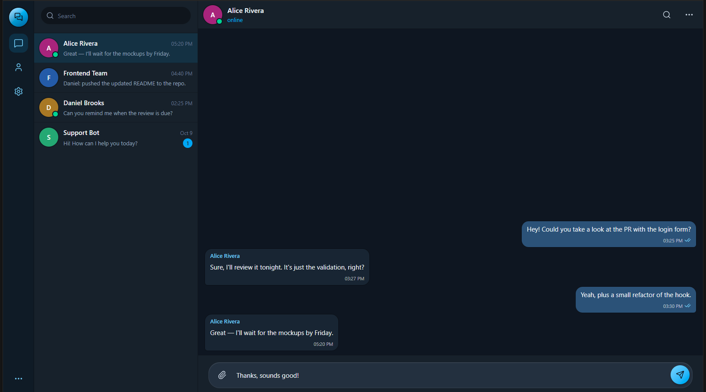

# Pulse Messenger

A Telegram-style messaging UI built as a frontend engineering showcase — responsive, accessible, and architected with **Feature-Sliced Design**. It ships with a mock backend that simulates network latency, delivery receipts, and auto-replies, so the whole experience is interactive without a server.

<p>
  
  
  
  
  
</p>

📦 **Repository:** _<!-- TODO: add GitHub URL -->_



> **Note on scope.** This is a **frontend demo**: there is no real server, database, or authentication. Messages, delivery status, and replies are produced by an in-memory mock "backend." The project is intentionally focused on UI architecture, state management, interaction design, and accessibility.

---

## Features

**Conversations**
- Direct and group chats with a sortable, searchable chat list
- Optimistic message sending with a three-stage delivery lifecycle: **sent → delivered → read** (rendered as single/double ticks, Telegram-style)
- Mock backend that simulates latency and generates context-aware auto-replies, including a dedicated **support bot** persona
- Unread badges that clear on open and increment for inactive chats
- Auto-scroll to the latest message, with graceful handling while searching

**Search**
- Global filter across chat titles and last messages
- **In-chat search** with match highlighting, `prev/next` navigation, and an `N/M` match counter
- Auto-scroll to the active match

**Personalization & management**
- Editable profile (display name, username)
- Per-chat settings: mute, rename a group, and a guarded "clear history" action
- App preferences: compact message bubbles and "press Enter to send" toggle

**UX & platform**
- Fully **responsive** master-detail layout — a two-pane desktop view collapses into a mobile, single-pane flow with back navigation
- Keyboard support (Enter to send, Shift+Enter for newline, Escape to close panels)
- Accessible markup: ARIA roles/labels, `aria-modal` dialogs, focus-friendly controls
- Dark, Telegram-inspired theme with safe-area insets for notched devices

---

## Tech stack

| Area | Choice | Why |
| --- | --- | --- |
| Framework | **React 19** | Modern function components and hooks |
| Language | **TypeScript** (strict) | End-to-end type safety across the domain model |
| Build tool | **Vite 8** | Fast dev server, instant HMR, lean production builds |
| Styling | **Tailwind CSS 4** (`@tailwindcss/vite`) | Utility-first styling with zero runtime cost |
| State | **Zustand 5** | Minimal, boilerplate-free global store with selective subscriptions |
| Icons | **lucide-react** | Consistent, tree-shakeable icon set |
| Utilities | **clsx** | Ergonomic conditional `className` composition |
| Tooling | **ESLint 9/10**, `typescript-eslint`, React Hooks rules | Enforced code quality and hook correctness |

---

## Architecture

The codebase follows **[Feature-Sliced Design (FSD)](https://feature-sliced.design/)** — a layered architecture that keeps a UI codebase scalable by enforcing a strict, one-directional dependency rule: a layer may only import from the layers **below** it.

```
app        →  application entry, providers, root composition
pages      →  route-level screens (MessengerPage)
widgets    →  self-contained UI blocks (ChatSidebar, ChatPanel, NavigationRail, …)
features   →  user-facing interactions with their own logic (send-message)
entities   →  business domains + state (chat store, message, user)
shared     →  framework-agnostic primitives (UI kit, lib helpers)
```

**Why this matters:** feature boundaries are explicit, cross-imports are predictable, and any slice can be reasoned about (or replaced) in isolation. When a real backend is introduced, it slots cleanly into each entity's `api/` segment without touching the UI layers.

### Project structure

```
src/
├─ app/                         # Root component (App layer)
├─ pages/
│  └─ messenger/                # Main screen, composes widgets responsively
├─ widgets/
│  ├─ navigation-rail/          # Left icon rail + "more" popover
│  ├─ chat-sidebar/             # Chat list with search
│  ├─ chat-panel/               # Header, message list, empty state
│  ├─ chat-settings-view/       # Per-chat settings (mute, rename, clear)
│  ├─ settings-view/            # App preferences
│  └─ profile-view/             # Profile editor
├─ features/
│  └─ send-message/             # Composer + send flow
├─ entities/
│  ├─ chat/                     # Zustand store, mock backend, seed data, types
│  ├─ message/                  # Message model
│  └─ user/                     # User model + constants
└─ shared/
   ├─ ui/                       # Avatar, AppLogo
   └─ lib/                      # cn(), format-time, use-media-query
```

The `@` path alias maps to `src/` (configured in `vite.config.ts` and `tsconfig`).

---

## Engineering highlights

A few decisions worth calling out for reviewers:

- **Optimistic UI with a realistic delivery lifecycle.** Outgoing messages render immediately, then transition `sent → delivered → read` as the mock backend "responds," mirroring how a production messenger feels over a real socket.
- **A single, well-shaped store.** All messenger state and actions live in one Zustand store. Components subscribe with **narrow selectors**, so a keystroke in the composer never re-renders the chat list.
- **Responsive master-detail without a router.** A `useMediaQuery` hook drives a single source of truth that collapses the two-pane desktop layout into a mobile stack — the same components, different composition.
- **In-chat search as derived state.** Matches are computed from messages + query rather than stored, keeping navigation (`prev/next`, active-match scroll, `N/M` counter) consistent and bug-resistant.
- **A viewport-aware popover.** The navigation-rail menu positions itself with `getBoundingClientRect`, re-flows on resize/scroll via a `ResizeObserver` and `visualViewport` listeners, and closes on outside-click.
- **Accessibility baked in**, not bolted on: semantic roles, `aria-modal` dialogs, labeled icon buttons, and full keyboard operation.

---

## Getting started

**Prerequisites:** Node.js 20+ and npm.

```bash
# 1. Install dependencies
npm install

# 2. Start the dev server (http://localhost:5173)
npm run dev

# 3. Create a production build
npm run build

# 4. Preview the production build locally
npm run preview

# 5. Lint
npm run lint
```

### Available scripts

| Script | Description |
| --- | --- |
| `npm run dev` | Start Vite dev server with HMR |
| `npm run build` | Type-check (`tsc -b`) and build for production |
| `npm run preview` | Serve the production build locally |
| `npm run lint` | Run ESLint across the project |

---

## Roadmap

Natural next steps if this grew into a real product:

- [ ] Replace the mock backend with a real API + WebSocket transport (the FSD `entities/*/api` segments are the seam)
- [ ] Authentication and per-user sessions
- [ ] Message persistence and pagination / infinite scroll
- [ ] Typing indicators and real presence
- [ ] Attachments and media previews (the composer already stubs file selection)
- [ ] Light theme + user-selectable themes
- [ ] Unit tests (Vitest) and component/E2E tests (Testing Library / Playwright)
- [ ] Internationalization (i18n)

---

## License

Released under the MIT License. See [`LICENSE`](LICENSE) for details.
